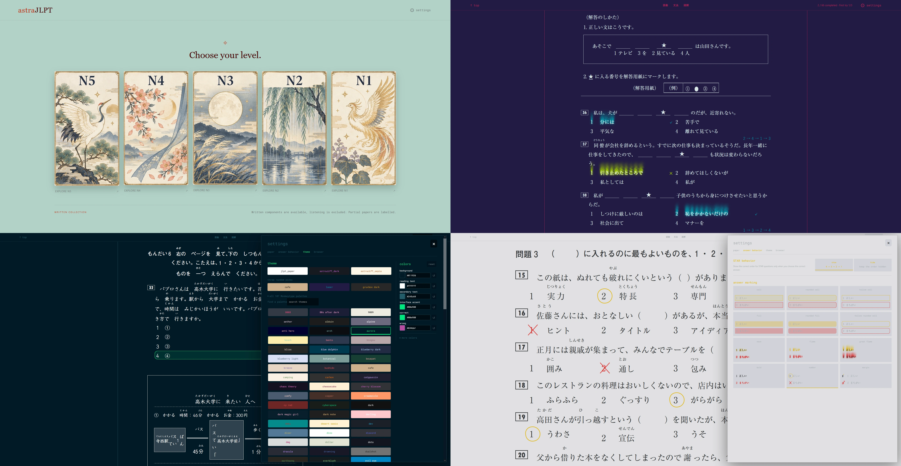

# astraJLPT-Editorial

I wanted JLPT materials that are pleasant to use as a website, easy to print as PDFs, and available as JSON for people who want to build something with them. astraJLPT Editorial brings those three versions together: interactive HTML on GitHub Pages, carefully typeset PDFs, and the editorial data and source code behind them.

**Website:** https://astrajlpt.github.io/astraJLPT-Editorial/



The present collection has 201 units covering vocabulary, grammar, and reading: modern N1–N5, older Levels 1–4, official workbooks, and samples. Some units are incomplete; their gaps and provisional choices are recorded. Listening is outside this release. You can practice in the browser, download a PDF, or give the JSON to your LLM agent and go wild. Regular and no-rubi HTML/PDF editions are available.

Mistakes were fixed by the LLM, GPT-6 Astra, at max reasoning effort. That means it compared available evidence and made editorial corrections; it does not mean every mistake was found or every reconstruction is certain. The public review records explain provisional fixes, alternatives, and remaining gaps.

## Jargons

<details>
<summary>Show terminology and definitions</summary>

**Unit**: An ID for an exam, workbook, sample collection, or expanded practice set. For example, `N1_07_2026`, `N2_workbook_2012`, `N1_sample_2009`, and `N1_set_2011_2012`. A unit ID identifies our collection entry; it does not by itself authenticate a historical exam sitting. Old Levels 1–4 are kept separate from modern N1–N5.

**UARS** (user-approved reference scans): Personally curated PDF files that I believe preserve real exam scans. Approval **may apply to specific page ranges, not the whole file**. It is my source judgment, not independent authentication by the test's organizers. The [reference-scan registry](editorial-json/user_approved_reference_scans.md) records exact files, hashes, page scopes, and exclusions.

**Base**: A unit with UARS evidence. The approval may cover specific page ranges rather than the whole file; a Base label does not imply that every part is complete or error-free.

**Workbook**: Official practice materials downloaded from the JLPT website. The 2012 and 2018 books contain roughly an exam's worth of questions selected from tests since the 2010 revision; each book is not necessarily one complete historical sitting. See the [official workbook description and downloads](https://www.jlpt.jp/e/samples/sampleindex.html).

**Sample**: Official questions published in 2009 to introduce the revised test's item types during the 2009–2010 reform from the old system. These may contain only a few examples per question type, rather than a full exam. See the [official sample collection](https://www.jlpt.jp/e/samples/sample09.html).

**Restored**: A unit outside the Base, Workbook, and Sample categories. Its sources are often retyped materials circulated in China or Vietnam, although the category also includes other reconstructions. Such materials frequently contain mistakes. The LLM fixed mistakes using source comparison and Japanese-language reasoning, with uncertain choices recorded for review.

**Principal PDF**: The main reference selected for comparison. A principal could in principle be another document format; our principal source material is PDF-based, sometimes comprising several PDFs recorded in a source-set manifest. A principal is not necessarily the uniquely best source and may be supplemented by official workbooks or other evidence.

**Principal Differences**: Recorded differences between our Editorial edition and its principal source. These include supported repairs, editorial choices, and uncertain reconstructions. A difference is not automatically a source error. A UARS principal can also have differences, including cases judged to be genuine mistakes in JLPT print.

**Unresolved cases**: Public records of *higher-risk* provisional fixes, unsettled alternatives, and missing content. Here, higher-risk means a choice or gap with meaningful remaining uncertainty, not necessarily a major error. The register also retains resolved entries and their explanations.

**Uncertainty Index**: Lower = better under this crude heuristic for sorting paper quality. It combines an evidence/provenance category with weighted concerns, including missing content and uncertain fields. A higher score does not simply mean more errors. The [current formula, weights, and sorting rules](editorial-json/uncertainty_index.json) are machine-readable. This is different from the archived “principal uncertainty index,” and is not a probability, an error count, or a prediction of practice difficulty.

**Differences, cases, and the Uncertainty Index**: A difference answers “what differs?”; a case answers “what remains uncertain, or how was it resolved?”; the index answers “where does this paper rank under our evidence-and-concern heuristic?” They overlap in evidence but serve different purposes. A confident correction can be a difference without an open case, and resolving a case does not necessarily erase the difference.

**Editorial PDF**: A high-effort astraJLPT recreation, built from the ground up with LuaLaTeX to follow JLPT fonts, spacing, and formatting. All 402 PDFs in the present regular/no-rubi release are below **1.4 MB each**; the largest is 1,330,058 bytes. That claim is about these Editorial PDFs, not the principal scans or future additions.

**Editorial JSON**: A more machine-friendly version of the content, so it is easy to convert into whatever you want. It preserves question structure, answers, explanations, and meaningful markup. See the [JSON guide](editorial-json/README.md).

**Editorial Audit**: Reviewing source pages, using OCR or extracted text to navigate them, comparing relevant sources, correcting transcription drops and language mistakes, and recording the evidence behind changes. OCR output and successful validation alone do not establish that an original page was read correctly.

**rubi**: Ruby / ふりがな: small reading aids, usually hiragana above kanji.

**rubi-restore**: The project that adds suitable reading aids where the source material has lost them, mainly in Restored units. It was developed from ruby observed in approved scans, workbooks, and samples. See the [introduction](rubi-restore/README.md), [research history](rubi-restore/RESEARCH.md), and [datasets and downloads](rubi-restore/SOURCES.md).

</details>

## Repository and developer details

```text
astraJLPT/                    Static website, including both PDF editions
pdf-render/                   Native generator, full fonts, schemas, and contracts
editorial-json/               Authoritative editorials, final ruby, public review records
editorial-json/private/       Working audits, source indexes, compressed fixlogs
additional-assets/principals/ Restored principals outside the deployed website
additional-assets/readme/     README screenshot
rubi-restore/                 Frozen scorer, policy, decisions, and replay inputs
.github/workflows/deploy.yml  Deploys only astraJLPT/
```

“Private” is a historical folder name: I didn’t originally intend to publish these working records, but they may be useful if you want to continue the work or understand why things are the way they are. They are included in this repository. Source paths beginning with `src/` refer to the separately maintained source collection; that whole collection is not bundled here.

Priority principals (official workbooks, UARS, and samples) are in `astraJLPT/assets/principals/`. Restored principals are in `additional-assets/principals/`. Review pages identify repository filenames for material outside the deployed site. Principal filenames describe the source document itself; they can cover several levels or years. Separate workbook PDFs retain their section suffixes.

### Identities and reproducibility

The active schema is `4.1.0`. There is one editorial and one installed final ruby sidecar per unit. The release removes unused import, listening, and inspection metadata while retaining explanations, public review records, private audit history, and frozen ruby research. The workspace's historical audit records were produced under earlier schemas; the adapted guide explains that boundary.

Publication-based IDs replace ten misleading sitting IDs. The versioned [unit alias map](editorial-json/unit_aliases.json) connects historical records to current units. The N1/N3 expanded sets are displayed as **Exam 2011/2012 · Workbook**; the existing warnings identify questions absent from the official download. Eight workbook units use their publication years. Printed PDF content, question IDs, annotation IDs, public case/difference IDs, and browser answer bindings are preserved. Old reader/review URLs redirect to the current units, and renamed readers retain their earlier browser storage keys.

Frozen research and audit records retain their original identities and hashes. [Resource bindings](pdf-render/contracts/resource-map.json) resolve packaged historical paths; reference-only evidence is explicitly distinguished from local rendering inputs. Reading a historical handoff does not activate its completed audit queue.

### Preview and validation

```sh
python serve.py
python verify.py
```

Open the localhost URL printed by `serve.py`. “Remember this browser” is enabled by default; preferences are shared across pages, while answers and position belong to a paper and rendition. Explicit opt-out is respected. Browser storage stays local to that browser and origin; it is not account/cloud synchronization. Serve the site from one origin, as GitHub Pages does. Direct `file://` browsing cannot reliably share storage between files.

`verify.py` checks packaged hashes, all 402 installed PDFs, local website links, and the website size budget. See [PDF regeneration](pdf-render/README.md), [the editorial data contract](editorial-json/audit-method/record-contract.md), and [ruby replay](rubi-restore/README.md#replaying-the-frozen-release) for the supported maintenance workflows. Generated outputs, environments, caches, and local publishing notes are ignored.
